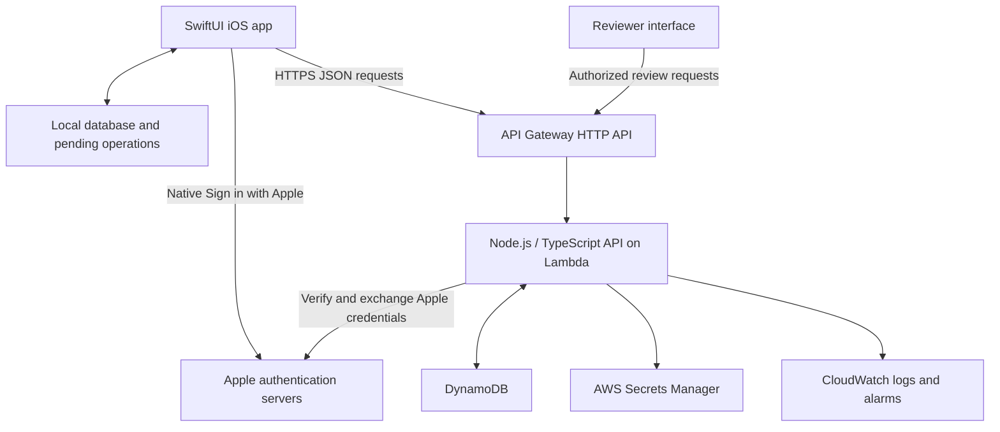

# Remnd backend architecture

Status: approved architecture direction; detailed API contracts and the open product decisions below still need to be finalized before implementation.

This document describes the backend we intend to build. It does not describe an already deployed system.

## Purpose and scope

`remnd` is the SwiftUI iOS client. `remnd-server` is the Node.js/TypeScript backend.

The backend will verify native Sign in with Apple, store account data, synchronize personal routines and daily progress, serve the public dua catalog, and support human review of public submissions.

The app currently stores profiles, routines, custom duas, pending submissions, and daily activity in `UserDefaults`. Discovery uses `MockData`. Apple sign-in currently identifies a local account without verifying its credential on a server or creating a cloud session.

The backend will preserve these existing daily routine rules:

- Each repetition is one card.
- A day follows the user's local calendar, rather than UTC midnight.
- Routine changes can update today's deck before the first completion.
- After the first completion, today's deck stays fixed and routine changes apply to the next day.
- A nonempty deck must be fully completed to count as a completed day.
- Yesterday's streak remains visible while today is in progress. A missed day breaks the streak.

## Architectural decisions

| Decision | Approach | Reason |
| --- | --- | --- |
| Application structure | One modular backend | Keep the domain rules together and make the initial system easy to develop and operate. |
| Language | Node.js with TypeScript | Use typed contracts and the AWS SDK while keeping the backend accessible to maintain. |
| Hosting | API Gateway HTTP API and Lambda | Handle HTTP requests without maintaining application servers. |
| Database | DynamoDB with on-demand capacity | Most operations read or update data for a known user, day, or dua. |
| Sign-in | Native Apple sign-in with server verification | Preserve the current Apple sheet and Face ID experience. |
| Application sessions | Remnd access tokens and renewable sessions | Apple proves identity; Remnd manages access to its own API. |
| API style | Versioned REST JSON API | Keep the iOS integration explicit and straightforward. |
| Client experience | Local storage and persistent pending operations | Reading and completing cards should continue without connectivity. |
| Cloud ownership | Backend stores canonical account data | Reconcile devices against one account state. |
| Public publishing | Human approval before catalog publication | Keep personal content private and public content reviewed. |
| Infrastructure | AWS CDK in TypeScript | Make environments reproducible and infrastructure changes reviewable. |
| Deployment geography | One AWS region initially | Choose the region based on the intended audience and data residency needs. |

AWS supports TypeScript through Lambda's Node.js runtime. DynamoDB on-demand charges for read and write requests without provisioned throughput planning. [Lambda TypeScript support](https://docs.aws.amazon.com/lambda/latest/dg/lambda-typescript.html), [DynamoDB capacity modes](https://docs.aws.amazon.com/amazondynamodb/latest/developerguide/capacity-mode.html).

## System layout

Start with one API Lambda and separate modules inside the codebase. Authentication, profile, catalog, personal duas, routines, daily decks, and submissions each own their validation and domain logic. HTTP handlers call those modules; repositories handle DynamoDB access.

Keep domain rules independent of Lambda request objects so they can be tested locally. A later need for independent scaling or background processing can justify extracting a module into another function.

No media storage is required for the current color-based avatars and text-only duas. Add S3 when there is an actual media feature. Introduce queues or workers when asynchronous tasks require reliable retries; the initial request flows do not require them.

## Native Apple sign-in and Remnd sessions

### Sign-in flow

1. The app asks the backend for a short-lived, single-use authentication challenge.
2. The app associates the challenge with the native Apple authorization request using a nonce. Define the raw-versus-hashed nonce convention consistently on both sides.
3. Apple returns an identity token and authorization code. The app sends these, the challenge identifier, and any first-sign-in name to the backend over HTTPS.
4. The backend validates the token signature against Apple's public keys, issuer, expected audience, expiry, and nonce. It validates the challenge and exchanges the single-use authorization code with Apple. Successful challenge consumption must be atomic so the same challenge cannot create another session.
5. The backend finds or creates a Remnd user using the verified Apple subject. Use an internal Remnd user ID for application records. Never trust a user ID supplied by the client as proof of identity.
6. The backend creates a Remnd session and returns a short-lived access token and a refresh token.
7. The app stores tokens in iOS Keychain and includes the access token on protected API requests.

Apple documents server verification of identity tokens and authorization codes, including signature, nonce, issuer, audience, and expiry checks. Apple's user name may only be supplied on the first authorization, so preserve it when received. [Verifying a user](https://developer.apple.com/documentation/signinwithapple/verifying-a-user), [Authenticating users with Sign in with Apple](https://developer.apple.com/documentation/signinwithapple/authenticating-users-with-sign-in-with-apple), [Apple public keys](https://developer.apple.com/documentation/signinwithapplerestapi/fetch-apple%27s-public-key-for-verifying-token-signature).

### Session design

- Issue signed Remnd access JWTs containing the internal user ID, session ID, issuer, audience, issue time, expiry, and signing key ID.
- Start with a proposed access lifetime of 15 minutes and an absolute renewable session lifetime of 30 days. Keep these configurable and review them before launch.
- Generate high-entropy opaque refresh tokens. Store their hashes, expiry, rotation state, and revocation state in DynamoDB.
- Rotate the refresh token when renewing a session. Use an atomic state change and a request identifier so a transport retry does not create multiple replacement tokens. Detect reuse outside the defined retry behavior and revoke the affected session family.
- Validate access JWTs in backend authentication middleware. Check the associated session's active state before protected operations so sign-out and account suspension can take effect immediately.
- Sign-out revokes the current Remnd session. Provide an operation to revoke all of a user's sessions.
- Keep Apple refresh credentials, if retained for account lifecycle operations, encrypted on the server. They are separate from Remnd refresh tokens and never go to the client.

Store Apple developer credentials and Remnd signing keys in Secrets Manager. Cache retrieved keys inside Lambda execution environments, use key IDs, and allow old verification keys to overlap during rotation. Do not place private keys or client secrets in the iOS app or repository.

Because Remnd issues its own tokens, the initial API performs token verification in its middleware. API Gateway's built-in Cognito authorizer is not part of this design. All protected routes must pass through authentication and ownership checks.

Implement Apple's signed account-change notification handling and account deletion/revocation flow before launch. Deleting an account must block further access, revoke its sessions, and remove its private data. Retention or attribution of already approved public contributions is an open decision.

## Data model

Use separate DynamoDB tables for these domains initially. Define exact keys and secondary indexes from the API access patterns before implementing repositories. Avoid table scans for normal app requests.

| Table/domain | Main data | Main access patterns |
| --- | --- | --- |
| Users | Internal ID, verified Apple identity mapping, profile, timezone preference, account state, creation time | Find account by verified Apple subject; read/update own profile |
| Auth state | Challenges, hashed refresh tokens, session families, expiry, revocation, rotation receipts | Consume challenge; validate session; renew/revoke session; list user's sessions |
| Catalog | Stable dua ID, content revisions, Arabic, transliteration, translation, benefit, source citation, publication state | List published entries; retrieve a dua revision |
| Personal duas | User ID, stable dua ID, content, revision, timestamps, deletion state | List/read/edit own private entries |
| Routines | User ID, current version, ordered entries with stable IDs and repetition counts; retained revisions | Read routine; replace it conditionally; retrieve a revision for reconciliation |
| Daily decks | User ID, local day, session ID, timezone, routine version, deck revision, content references, goal, completed count, completion records | Get a day's deck; deduplicate completions; retrieve activity metadata for a date range |
| Submissions | Submission ID, owner, submitted content snapshot, status, review decision, reviewer, timestamps, resulting catalog ID | List own submissions; list pending review; approve/reject |

Catalog content revisions must remain addressable while decks refer to them. A content correction must not silently alter an already started deck. Daily decks store an ordered manifest of routine entries and their content revisions rather than copying all Arabic text into every day's record.

Represent a day's metadata and individual completion markers as separate records in the daily-deck table. This keeps completion deduplication explicit and avoids an indefinitely growing array in one DynamoDB item. Profile charts read daily metadata, not every completion record.

Enforce configured limits for text length, routine size, repetition counts, deck size, and submission frequency. These protect the API and keep snapshots within DynamoDB item and transaction limits. Final values belong in the API contracts.

Use strongly consistent base-table reads where session validity or immediate post-write progress matters. Discovery and review-list indexes can tolerate brief propagation delays. Global secondary indexes support eventually consistent reads. [DynamoDB read consistency](https://docs.aws.amazon.com/amazondynamodb/latest/developerguide/HowItWorks.ReadConsistency.html).

## Routine and daily deck behavior

### Routine configuration

Treat a saved routine as one ordered document with a version number. Each entry has a stable entry ID, dua reference, repetition count, and position.

A save includes the version the client edited. Update only if that version is still current. Return a conflict and the latest routine when another device has already saved a newer version. Preserve the local draft so the app can let the user review and reapply it.

When today's deck has no completions, a routine save may replace its manifest and increment the deck revision. Once started, the day's manifest remains fixed. Routine updates and first-card completions must check the same deck revision atomically so a race cannot change the target after progress begins.

### Daily deck

Create a deck on demand when the user needs it. A scheduled midnight job for every user is unnecessary.

For example, three SubhanAllah repetitions and two Alhamdulillah repetitions create a goal of five cards. Completing all five makes the day complete. Changing the routine after the first completion affects the next day's deck.

Each deck includes a local day such as `2026-10-06`, an IANA timezone such as `Australia/Adelaide`, and the corresponding UTC boundaries. Use calendar-aware timezone calculations so daylight-saving changes do not turn a local day into an assumed fixed 24-hour interval.

Pin the timezone for an existing deck. A device timezone change must not rewrite historical activity. The exact rule for starting a new deck after travel remains open.

Each card has a stable identity derived from its deck revision, routine entry, and repetition index. On completion, atomically create its completion marker and increase the day's count only if that marker does not exist and the deck revision matches. A repeated request returns the existing result without adding another completion. DynamoDB conditional writes and transactions support these concurrency requirements. [Conditional writes](https://docs.aws.amazon.com/amazondynamodb/latest/developerguide/WorkingWithItems.html), [Concurrent update guidance](https://docs.aws.amazon.com/amazondynamodb/latest/developerguide/BestPractices_ImplementingVersionControl.html).

### Activity and streaks

Use daily deck metadata as the source for activity and streak calculations. Do not accept an independently submitted streak number from the client.

- A day is complete when its goal is greater than zero and all its cards are complete.
- Count consecutive completed calendar dates backward from today if today is complete, otherwise from yesterday.
- Missing or incomplete intervening dates break the streak.
- An empty routine does not award a streak day.
- Accepted late offline completions can change historical activity and the resulting streak.

Calculate the summary on reads initially. Add a derived cache only if measurement shows that it is needed; retain daily records as the source of truth.

## Offline use and synchronization

Move the client toward a local database with a durable queue of pending operations. SwiftData is a candidate; the exact client storage implementation is a separate decision. Use Keychain for credentials.

The UI reads local data and saves a completion locally before sending it. Synchronize on app launch, foreground entry, after changes, and when connectivity is available. Do not rely on iOS background execution to guarantee delivery.

Every queued operation has a stable request ID. Every completion also identifies its deck, deck revision, and card. Return acknowledged operations and canonical progress so the client can reconcile its cache. Batch queued completions to reduce requests; do not lose acknowledged progress if one event in a batch conflicts.

Use these conflict rules:

- **Card completions:** merge by unique card identity. Two devices completing the same card count once. Different cards in the same deck can merge.
- **Routine edits:** check the expected version and report a conflict rather than silently replacing newer settings.
- **Profile and personal dua edits:** check record revisions and preserve a conflicting local draft.
- **Creates and submissions:** reuse stable client IDs/request IDs so retries do not create duplicates.
- **Deletes:** retain a deletion marker long enough for an older device to learn about the removal. The retention window remains open.

An offline device can start a provisional deck using a previously downloaded routine revision. The backend must verify that revision belongs to the user and is eligible under the offline policy. If another device already established a different deck for the same day, reconcile against that canonical deck; do not combine different targets or silently discard pending activity. The precise user-facing resolution is an open decision that must be settled before sync implementation.

Store both the client-reported occurrence time and server receipt time for offline activity. An event received after midnight can belong to an earlier deck. Define a maximum late-sync window and timestamp validation rules before implementation. A backend cannot prove the actual time of an action performed entirely offline; the acceptance policy should reflect that limitation.

Serve a versioned catalog and an account-state bootstrap response first. Introduce cursor-based incremental synchronization when full refreshes become costly. Cross-device updates can appear on foreground refresh; instantaneous push synchronization is not required initially.

## Public submission and review

Private creation and public submission are separate operations. Submitting a dua does not make it discoverable or automatically add it to the personal routine, matching the current UI's two separate buttons.

Use submission states `pending`, `approved`, and `rejected`. Store the submitted content as a snapshot so later edits to a personal copy do not change what the reviewer is reviewing.

Review Arabic text, meaning, transliteration, benefit claims, and supporting sources. Keep reviewer identity, decision, feedback, and timestamps. Approval creates or links a published catalog entry and records the decision atomically. Repeated approval must not publish duplicate entries.

Reviewer privileges come from backend-controlled account roles. Ordinary clients cannot assign roles, approve submissions, or set publication status. A small reviewer interface can be built separately; the initial architecture defines its protected API.

## Proposed API surface

All application routes use `/v1`. These are proposed operations, not finalized request/response schemas.

| Method and path | Purpose |
| --- | --- |
| `POST /v1/auth/apple/challenge` | Create a sign-in challenge |
| `POST /v1/auth/apple` | Verify Apple credentials and create a Remnd session |
| `POST /v1/auth/refresh` | Rotate refresh credentials and renew access |
| `POST /v1/auth/sign-out` | Revoke the current session |
| `POST /v1/auth/sign-out-all` | Revoke all own sessions |
| `POST /v1/auth/apple/notifications` | Receive and verify Apple account-change notifications |
| `GET /v1/bootstrap` | Load profile, routine, relevant personal content, today's deck, and recent activity |
| `GET /v1/me` / `PATCH /v1/me` | Read/update own profile |
| `DELETE /v1/me` | Start account deletion and revoke access |
| `GET /v1/catalog` | List published catalog content with pagination/version information |
| `GET /v1/catalog/:duaId` | Retrieve published dua content |
| `GET /v1/me/duas` / `POST /v1/me/duas` | List/create private duas |
| `PATCH /v1/me/duas/:duaId` / `DELETE /v1/me/duas/:duaId` | Edit/delete own private dua |
| `GET /v1/me/routine` / `PUT /v1/me/routine` | Read/save the ordered routine with a version check |
| `POST /v1/me/decks/ensure` | Create or retrieve a canonical daily deck, including provisional offline reconciliation |
| `GET /v1/me/decks/:day` | Read a daily deck |
| `POST /v1/me/decks/:day/completions` | Submit a batch of identified card completions |
| `GET /v1/me/activity?from=...&to=...` | Retrieve daily activity and streak summary |
| `POST /v1/me/submissions` / `GET /v1/me/submissions` | Submit content and track own review status |
| `GET /v1/admin/submissions` | List submissions for authorized reviewers |
| `POST /v1/admin/submissions/:id/review` | Approve/reject and record the review |
| `POST /v1/me/import` | Import eligible existing device data once, with retry protection |

Use the authenticated identity to scope `/me` operations. Validate input, return consistent error codes and request IDs, and paginate list responses. Version conflicts use `409 Conflict`. Decide whether catalog browsing requires sign-in when finalizing the contracts; the app currently requires sign-in to reach Discovery.

## Importing existing local data

After successful server sign-in, offer an authenticated import of existing device data into an empty cloud account. Preserve custom dua IDs and routine entry IDs when valid, and map bundled catalog IDs to their backend equivalents.

Make import idempotent and record its result. If cloud data already exists, require an explicit reconciliation flow rather than replacing it with the device snapshot.

Historical local progress was recorded before server verification. Define whether to accept it as imported history and label its origin internally. Existing pending submissions should become actual review requests only through a deliberate import step; local pending status is not evidence of server submission.

Keep device caches and pending operations scoped to the internal Remnd account. Signing out must not show the previous account's private data to the next user.

## Operations and verification

- Use separate development and production AWS environments, preferably separate accounts. Keep tables, secrets, permissions, and deployment configuration separate.
- Give Lambda roles access only to the resources each operation needs. Do not ship AWS administrative credentials to the app.
- Apply API throttling and application limits for authentication and submissions. Avoid logging tokens, authorization codes, private dua text, or profile bios.
- Use structured CloudWatch logs with request IDs and metrics for API errors, latency, sign-in failures, sync conflicts, and rejected completion requests.
- Alert on elevated error rates, throttling, and unexpected spending. Set log retention and billing budgets.
- Enable DynamoDB recovery and verify restoration procedures before launch.
- Deploy infrastructure through CDK and application changes through CI. Document the supported Node runtime and dependency update process when the project is initialized.
- Define record revisions so deployments and schema changes can remain compatible with older installed iOS versions.

Test the domain rules and the risks introduced by cloud sync: nonce replay, wrong Apple audience, token expiry/revocation, refresh retries, unauthorized data access, duplicate completions, concurrent routine edits, first-completion races, midnight and daylight-saving boundaries, offline reconciliation, repeated review approval, and repeated imports. Use AWS development-environment integration tests for DynamoDB transaction behavior as well as local unit tests.

## Implementation stages

1. **Foundation and authentication:** initialize TypeScript and CDK, deploy a development API, implement verified native Apple sign-in and Remnd sessions, and connect the iOS client.
2. **Cloud account data:** seed the catalog, implement profiles, private duas and versioned routines, and add controlled local-data import.
3. **Daily progress and sync:** finalize offline/timezone policies, implement canonical decks and completion deduplication, add local pending operations, and verify streak behavior across devices.
4. **Submission review:** implement real submissions, reviewer authorization, decisions, publication, and status display in the app.
5. **Release readiness:** finish account lifecycle handling, operational alarms, recovery checks, limits, and production deployment configuration.

## Open decisions

These are intentionally not presented as settled architectural decisions:

| Decision | What needs to be agreed |
| --- | --- |
| AWS region | Intended audience, latency, and data residency requirements |
| Offline acceptance | Maximum late-sync window and handling of implausible client timestamps |
| Travel and timezone changes | When a new timezone takes effect and how repeated/skipped local dates behave |
| Conflicting provisional decks | What the user sees when offline devices start different targets for the same day |
| Routine conflict experience | How the app presents and reapplies conflicting local edits |
| Initial progress import | Whether existing local history counts toward cloud streaks |
| Submission import | How users choose which existing local submissions to send for real review |
| Account deletion | Retention/attribution policy for approved public contributions and private deletion timelines |
| Record retention | Completion history, consumed authentication challenges, refresh retry receipts, logs, and deletion markers |
| Product limits | Text lengths, routine/deck size, repetitions, submissions, and date-range query bounds |
| Reviewer workflow | Who reviews content, required source information, and how rejection feedback is shown |
| Public catalog access | Whether catalog endpoints allow browsing before sign-in |

